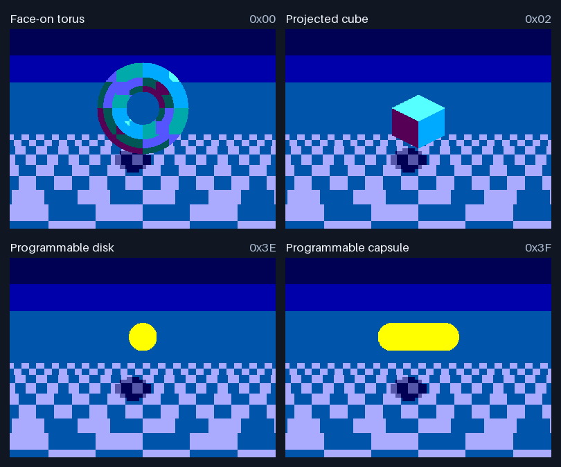
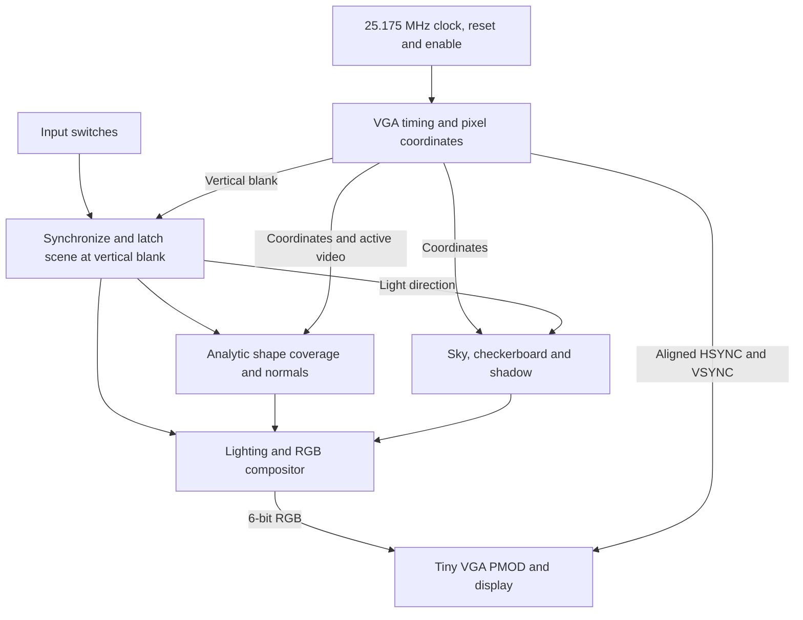

# RayForge-X

RayForge-X is a **single-tile VGA graphics ASIC** for Tiny Tapeout TTSKY26e. It draws two torus views, a projected cube, and programmable disks and capsules. Set an input word to choose a shape, its size where supported, or a display mode. The chip generates each pixel as the VGA beam advances.



[Scene gallery](docs/images/visual-gallery.png) · [Interactive VGA demo](docs/demo.html) · [Physical layout viewer](https://s-sujan-s.github.io/tt_um_rayforge_3d/)

Download the demo HTML and open it in a browser to explore 40 VGA captures, including all 32 programmable profiles.

## System architecture



1. **Capture the controls.** Two flip-flops synchronize the switch word. The chip latches it during vertical blank after a full stable frame interval. Reset release is synchronized to the same pixel clock.
2. **Scan the raster.** Hardware counters supply the current pixel position and active-video flag. Each frame has 800 × 525 total samples, including blanking.
3. **Classify the pixel.** The geometry pipeline computes object coverage. A shared 15-bit accumulator evaluates the curved silhouettes with finite differences. Fixed integer comparisons classify the cube faces.
4. **Build the background.** A parallel path generates the checkerboard and screen-space shadow. The sky, floor and object paths are aligned before compositing.
5. **Compose and output.** The shader selects lit colors, normal colors, a depth proxy, or a silhouette. The chip emits two bits per color channel and aligned sync signals at one sample per clock. The display shows 640 × 480 pixels at 59.94 Hz.

The rendering path uses three registered stages and operates without a framebuffer or external memory. A mode-dependent seed lets the torus, disk and capsule share the same accumulator and pair of coverage comparisons. A separate on-chip visibility self-test samples the pre-pad RGB stream and reports status on the auxiliary pins. [Detailed RTL flowchart and module map](docs/architecture.md)

## Try an input

| Input word | Frame shown |
| --- | --- |
| `0x00` | Lit face-on torus |
| `0x02` | Lit projected cube |
| `0x04` | Lit edge-on torus |
| `0x08` | Face-on torus normals |
| `0x3E` | Disk, radius about 33.94 px |
| `0x3F` | Capsule, end-cap radius about 33.94 px |

In programmable mode, one switch selects the shape family and four switches select one of 16 squared radii. For `0x3F`, the decoder selects a capsule with radius code 7. The geometry stage tests each pixel against the squared radius `256 + 128 × 7 = 1,152` and displays the covered pixels in yellow. Shape centers and capsule length are fixed. [Full input encoding and examples](docs/programmable-geometry.md)

## Hardware and simulation

Connect a Tiny VGA PMOD, supply a 25.175 MHz clock, select the design, and release reset. Start with the scene inputs low for the lit face-on torus. Hold a new input word steady for up to two frames to apply it. [Pinout and bring-up](docs/info.md)

To simulate, install Icarus Verilog, GNU Make and Python, then run the following from the repository root.

```sh
python -m pip install -r test/requirements.txt
make -C test
bash test/run-rtl.sh
```

The Sky130HD design occupies one 161.000 × 111.520 µm tile. The verified hardware build mapped to **11,347.1328 µm²**. [Verification procedure](docs/verification.md) · [Tiny Tapeout build and precheck](https://github.com/S-SUJAN-S/tt_um_rayforge_3d/actions/runs/44466026180)

## Project files

| Path | Contents |
| --- | --- |
| [`src/`](src) | Synthesizable Verilog and physical design constraints |
| [`info.yaml`](info.yaml) | Tiny Tapeout manifest, clock, tile size and pin labels |
| [Architecture](docs/architecture.md) | Complete signal flow, VGA timing, geometry and diagnostic |
| [Datasheet](docs/info.md) | Hardware setup and switch controls |
| [Research manuscript](docs/manuscript.md) | Literature, shared accumulator derivation, and evaluation |
| [Reproduction scripts](research/README.md) | Geometry equivalence proof and synthesis experiment |
| [`test/`](test) | Cocotb and standalone raster simulations |

## Credits & Course Affiliation

This project was executed by **Sujan S, Tejasvi R Shankar, Yogesh Mahesh Bisnal, and Prathik P Kekare** as an **Experiential Learning (EL)** project under the **VLSI Physical Design course (EC373TA)**, under the guidance of **Dr. Shylashree N** (Course Faculty & Guide).

We sincerely thank the Department of Electronics and Communication Engineering (ECE) and RV College of Engineering (RVCE), Bangalore, for their continuous support and academic resources in facilitating this tapeout.

[Apache 2.0 license](LICENSE)
